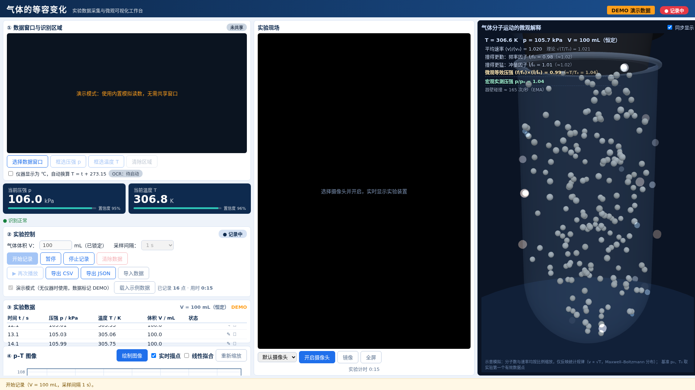
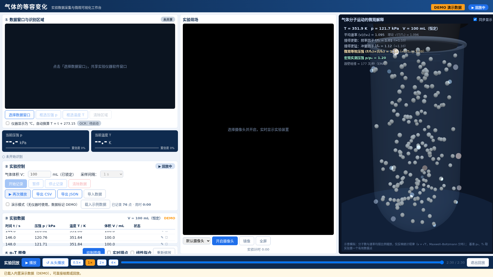
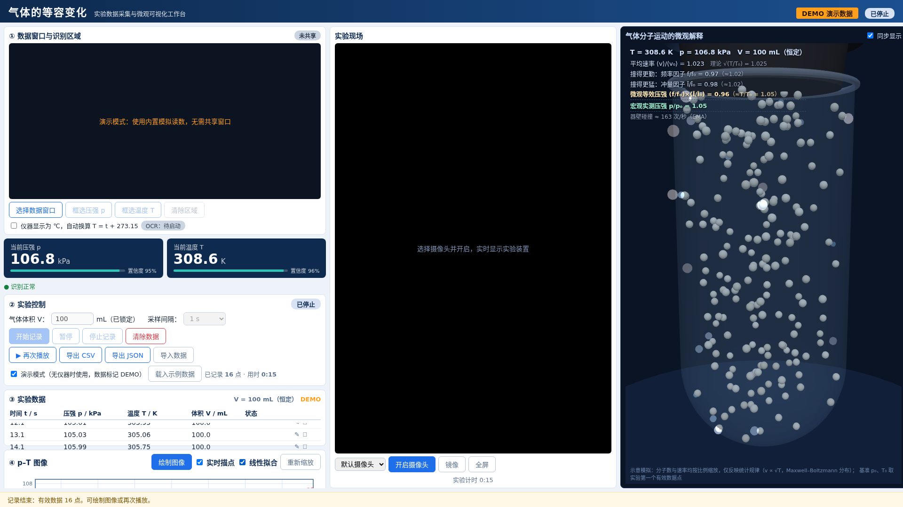
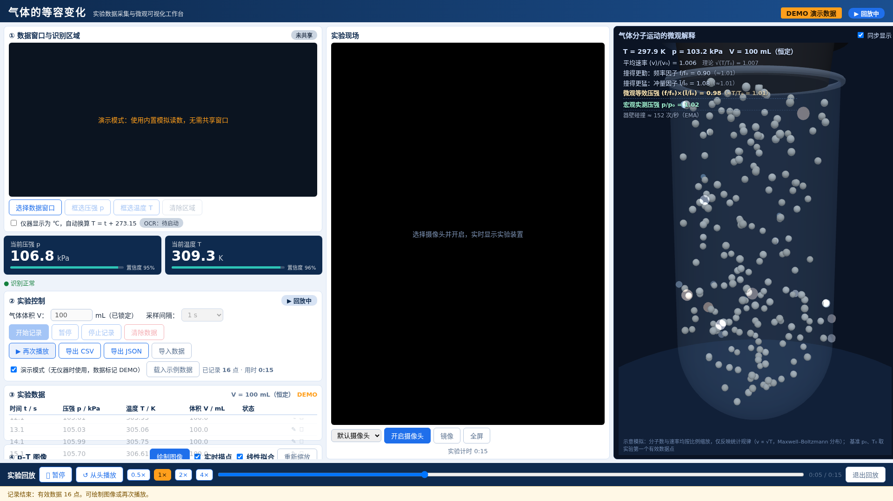
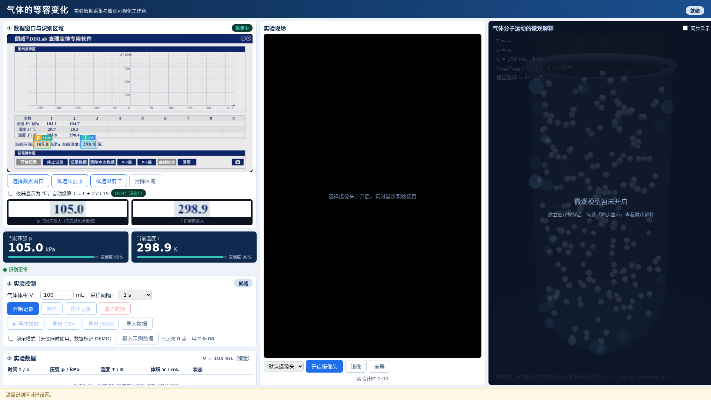

# 气体的等容变化 · 实验数据采集与微观可视化工作台（C+KIMI K3）

> Isochoric Gas Workbench —— 面向高中物理课堂的数字化实验工作台：
> **仪器软件屏幕 OCR 采集 × 实景摄像头 × Maxwell–Boltzmann 三维微观仿真 × p–T 图像与复盘回放**



[](LICENSE)
[](https://react.dev)
[](https://threejs.org)
[](#测试与验证)

**English abstract**: A web-based teaching workbench for the high-school physics experiment "isochoric process of gases (Charles's law / Gay-Lussac's law)". It captures pressure/temperature readings from existing instrument software via user-authorized screen sharing + numeric OCR (no hardware SDK required), records time-series data, plots the p–T relation with least-squares fitting, and synchronously drives a Maxwell–Boltzmann 3D molecular simulation that closes the macro-micro evidence loop. Built on the open-source [physics-software-sensors](https://github.com/WUHAO19831214/physics-software-sensors) sensor layer.

---

## 一、项目简介

这是一个配合中学物理"**气体的等容变化**"演示/分组实验使用的网页工作台。实验中一定质量的气体被封闭在玻璃试管中（体积 V 恒定），水浴加热改变温度，压强传感器与温度传感器实时测量 p 和 T，仪器配套软件（如朗威 DISLab）在电脑窗口中显示读数。

工作台在一张 1920×1080 的课堂投屏页面上同步呈现三栏：

| 左栏 36% | 中栏 32% | 右栏 32% |
|---|---|---|
| 数据采集与处理：窗口共享 + 双 ROI 数字 OCR、实时读数、数据表、p–T 图像与线性拟合 | 真实实验现场：摄像头实时画面 | 微观解释：Three.js 试管内分子热运动 3D 仿真，因式分解式宏微观对比看板 |

核心教学价值是形成一条完整证据链：

```
真实实验 → 仪器软件屏幕数据 → OCR 采集 → 实验数据表 → p–T 图像 → 宏观规律 → 气体分子微观模型
```

## 二、开发背景与要解决的问题

1. **许多 DIS 传感器没有公开 SDK**：仪器数据只能在厂商软件窗口里看，无法直接进入学生的数据分析流程。本项目用"用户授权的窗口共享 + 屏幕区域数字 OCR"桥接这一步——不修改仪器软件、不接触硬件驱动。
2. **宏观规律与微观解释脱节**：课堂上 p ∝ T 的规律得出后，"为什么"通常只能靠口头讲解。本项目让分子热运动模型由**实验实测温度单向驱动**，并把压强的微观成因因式分解为"撞得更勤 × 撞得更猛"，与传感器实测压强并排闭环。
3. **课堂节奏需要防剧透与可复盘**：微观模型默认关闭（先建立宏观规律，再看微观解释）；实验结束后可按原时间轴完整回放（表格、图像、分子模型三区联动）。
4. **实验数据诚实性**：OCR 可能误识别，工作台对数据进行置信度阈值、物理范围、历史基线交叉验证、多尝试多数表决等多重把关，无效数据绝不静默写入，也绝不擅自"修正"。

## 三、核心功能

- **屏幕数据窗口采集**：选择仪器软件窗口（getDisplayMedia），在预览上框选压强/温度两个识别区域（ROI），Tesseract.js 数字 OCR 以 2 Hz 输出读数与置信度；识别区放大调试视图实时显示 OCR 的输入与原始识别文本；支持 ℃→K 自动换算开关。
- **实验记录**：固定体积 V 记录时锁定；采样间隔 0.5/1/2/5 s 可调；开始/暂停/继续/停止/清除（二次确认）；数据表 t/p/T/V 四列，最新行高亮，单行编辑（标记人工修正）与删除；无效采样跳过并计数提示。
- **p–T 图像**：横轴 T/K、纵轴 p/kPa 散点图，"实时描点"开关可在记录中实时上图；最小二乘拟合 p = aT + b（不强制过原点），显示斜率、截距与 R²；平均 p/T 统计。
- **复盘回放**：按原始时间轴重演——表格逐行高亮、p–T 图逐点重现、微观模型按历史温度演绎；播放/暂停/从头、0.5–4× 倍速、进度条拖动三区同步跳转。
- **微观 3D 仿真**：透明玻璃圆底试管 + 橡胶塞，200 个分子按 Maxwell–Boltzmann 分布运动，与器壁完全弹性碰撞；温度变化时全体速率 × √(T₂/T₁)；碰撞微闪光按法向速率做冷蓝→暖金能量分级。
- **宏微观对比看板**（教学核心，见下文"项目特色"）。
- **摄像头面板**：设备枚举与切换、开启/关闭、镜像、全屏，权限/占用异常中文提示。
- **数据管理**：导出 CSV（Excel 兼容）/ JSON（含完整元数据）、导入 JSON 回放；localStorage 自动保存最近会话，刷新不丢数据。
- **演示模式**：无仪器时用明确标记 DEMO 的模拟数据走完整流程，便于备课与调试。

## 四、项目特色

### 1. 真实复用开源传感器层，而非重新造轮子

屏幕采集与数字 OCR 直接依赖同作者开源仓库 [physics-software-sensors](https://github.com/WUHAO19831214/physics-software-sensors) v0.6.0 的核心包（`vendor/` 内置 tgz，SHA256 见下文"依赖"），遵守其"**直接观测与物理量解释分离**"原则：OCR 输出是"仪器软件显示画面的识别结果"，raw_text、置信度、时间戳全程保留，识别失败只产生错误事件，绝不生成虚构数值。

### 2. 物理严格的分子模型

- 分子速度三个分量按 N(0, k_BT/m) 高斯抽样（等价于 Maxwell–Boltzmann 速率分布），粒子有快有慢；
- 温度变化时全体速率 × √(T₂/T₁)，统计上严格满足 v_rms ∝ √T，且保留每个分子的运动方向，不会"所有分子瞬间同速"；
- 与试管壁完全弹性碰撞（单元测试验证能量守恒与器壁约束）；
- 明确标注：分子数与速率均按视觉比例缩放，仅反映统计规律——这是教学可视化模型，不是科研级分子动力学。

### 3. 因式分解式宏微观证据链（教学解释力核心）

右侧 HUD 不只给一个"碰撞次数"，而是按分子动理论核心考点分解：

```
平均速率因子   ⟨v⟩/⟨v₀⟩  ≈ √(T/T₀)   （全体分子统计，稳定锚）
撞得更勤      频率因子 f/f₀  ≈ √(T/T₀) （碰撞事件 EMA 实测）
撞得更猛      冲量因子 Ī/Ī₀  ≈ √(T/T₀) （碰撞事件 EMA 实测）
微观等效压强   (f/f₀)×(Ī/Ī₀) ≈ T/T₀
宏观实测压强   p/p₀                      （传感器数据）
```

基准 p₀/T₀ 自动取实验第一个有效数据点；微观统计基准在"同步 + 温度对齐 T₀"的当前态定时积累 1.5 s 捕获，避免瞬态污染。实测：升温至 T/T₀ ≈ 1.23 时，微观合成 1.14、宏观实测 1.20，偏差约 5%。



### 4. 数据质量四道关

1. OCR 层：多预处理尝试**多数表决**（≥2 个尝试同值才采纳，绝不猜数）；
2. 读数层：置信度阈值显示（低置信读数不冒充正常读数）；
3. 记录层：物理范围检查 + **历史基线交叉验证**（等容升温平缓，瞬时偏离基线 15% 判定识别框串行，跳过并提示）；
4. 教师层：跳变点标记"待确认"、单行可删可改（改动显式标记"人工修正"）。

## 五、工作原理与数据流

```
教师点击「选择数据窗口」（用户手势 = 浏览器权限边界）
  └─ screen.capture: getDisplayMedia → 窗口像素流（预览 ~7 Hz）
       └─ 教师在预览上框选两个 ROI（压强 p / 温度 T）
            └─ ocr.number: ROI 裁剪 → 放大/灰度预处理 → Tesseract.js（本地资源，离线可用）
                 │   多数表决恢复；保留 raw_text / confidence / timestamp；失败 → error 事件
                 ▼
            liveBus 实时读数总线（OCR 2 Hz）──→ 大号读数卡片 + ROI 调试视图
                 │  按采样间隔（与 OCR 频率分离）
                 ▼
            RecorderController：置信度/范围/历史基线交叉验证
                 │  无效帧跳过并提示，绝不静默写入、绝不擅自修正
                 ▼
            实验数据表（t/p/T/V，V 恒定）──→ p–T 散点图 + 最小二乘拟合
                 │  「同步显示」开启时（回放时由回放时钟接管）
                 ▼
            GasModel：T 单向驱动分子速率分布（v ∝ √T）
                 └─→ 器壁碰撞统计 → 因式分解看板 ← 对照实测 p/p₀
```

频率分离设计：屏幕预览 ~7 Hz、OCR 2 Hz（串行闸门防队列积压）、实验记录默认 1 Hz、3D 动画 requestAnimationFrame——互不阻塞。

## 六、技术架构与模块

| 层 | 模块 | 职责 |
|---|---|---|
| 传感层 | `@physics-software-sensors/core`（npm tgz） | `ScreenCaptureSource`/`NumberOCRSensor`/`TesseractJsRecognizer` 及其 FramePacket/SensorEvent 契约 |
| 识别层 | `src/services/BrowserNumberRecognizer.ts` | 屏幕小字体放大 + 平滑灰度 + 多尝试多数表决恢复；本地 OCR 资源（离线）；识别器级串行闸门 |
| 控制层 | `src/controllers/` | OCR 组装（ocrController）、统一实验时钟与数据质量（recorder）、回放时间轴（replay）、演示数据源（demo） |
| 物理层 | `src/physics/` | Maxwell–Boltzmann 抽样、试管容器与弹性碰撞（gasModel）、最小二乘拟合（fit）——与渲染完全解耦，可独立测试 |
| 状态层 | `src/state/` | 状态机（IDLE/CONFIGURING/READY/RECORDING/PAUSED/STOPPED/REPLAYING）+ 高频数据双通道总线（liveBus） |
| 表现层 | `src/components/` | 三栏 React 组件（采集面板/读数/控制/表格/图表/摄像头/3D 仿真/回放条） |

**技术栈**：React 18 + TypeScript + Vite · Three.js（WebGL）· Tesseract.js v7（本地 worker/wasm/语言数据，约 54 MB 内置于 `public/ocr/`，**完全离线可用**）· Vitest（单元测试）· Playwright（端到端验证，开发期使用）。

## 七、目录结构

```
├── index.html
├── package.json              # 依赖含 vendor/ 本地 tgz
├── vite.config.ts / tsconfig.json
├── 启动工作台.command         # macOS 一键启动器（自动修复跨平台依赖、写日志、开浏览器）
├── public/ocr/               # Tesseract 本地资源（离线 OCR 的关键）
├── vendor/
│   └── physics-software-sensors-core-0.3.0.tgz   # 传感器核心包（MIT，SHA256 见下）
├── src/
│   ├── types.ts                    # 统一数据模型（Session/DataPoint/状态机类型）
│   ├── state/ExperimentContext.tsx # 全局状态 + 状态机 + 按钮可用性
│   ├── state/liveBus.ts            # 高频实时数据总线（reading/sim 双通道）
│   ├── controllers/                # ocrController / recorder / replay / demo
│   ├── services/                   # BrowserNumberRecognizer / ocrRecovery
│   ├── camera/cameraCapture.ts     # camera.capture 的 Web 适配层（getUserMedia）
│   ├── physics/                    # maxwellBoltzmann / gasModel / fit
│   ├── components/                 # 三栏 UI 组件
│   └── utils/                      # CSV/JSON 导出、localStorage 持久化
├── tests/                      # 物理模型 + 记录器单元测试（13 项）
└── docs/images/                # README 截图
```

## 八、安装与运行

**环境要求**：Node.js ≥ 18（推荐 20+）；Chrome / Edge 最新版（**推荐 Chromium 内核**——屏幕共享与 OCR worker 兼容性最好；Safari 下 OCR 引擎可能不稳定）；页面必须通过 `localhost` 或 HTTPS 访问（浏览器对 getDisplayMedia/getUserMedia 的安全限制）。

```bash
npm install        # 安装依赖（含 vendor/ 本地 tgz）
npm run dev        # 开发模式 → http://localhost:5180
npm test           # 13 项单元测试（物理模型 + 数据质量）
npm run build      # 生产构建到 dist/
npm run preview    # 预览生产构建
```

macOS 用户也可以直接双击 `启动工作台.command`：自动检测/修复跨平台依赖、端口占用回退（5180→5181）、启动后自动打开浏览器，并把过程写入 `启动日志.txt` 便于排查。

## 九、典型课堂使用流程

1. 打开页面（无仪器时可先勾选「演示模式」体验全流程，数据全程带 DEMO 标记）；
2. 点击「选择数据窗口」，共享仪器软件窗口；
3. 分别「框选压强 p」「框选温度 T」——**只框数值本身**，借助"识别区放大"视图确认数字完整（若仪器显示 ℃，勾选自动换算开关）；
4. 设置气体体积 V（如 100 mL）与采样间隔（默认 1 s）；
5. 中栏选择并开启摄像头，让学生看到真实装置；
6. 点击「开始记录」，水浴加热，工作台自动按间隔记录 t/p/T/V（可开"实时描点"让 p–T 图同步生长）；
7. 规律建立后勾选「同步显示」，右侧分子运动随实测温度加剧，看板显示宏微观相对值闭环；
8. 点击「停止记录」→「绘制图像」→ 可选「线性拟合」验证 p ∝ T；
9. 点击「再次播放」，实验全程按原时间轴三区联动重演；
10. 「导出 CSV/JSON」供课后分析；刷新页面数据自动恢复。





## 十、OCR 识别效果

对朗威 DISLab 查理定律软件真实画面做端到端回归测试（模拟窗口共享走完整管线：screen.capture → ROI → OCR → 读数卡片），识别 **p = 105.0 kPa / T = 298.9 K 与画面真实值一致，置信度 95%+**；40 秒连续采样无压强/温度通道串扰。



*（图中为测试用的朗威 DISLab 软件窗口画面，仅用于说明 OCR 工作过程。）*

## 十一、当前版本已实现

三栏工作台全部核心功能：窗口共享 + 双 ROI 数字 OCR（离线、多数表决恢复、串行防积压）、ROI 调试视图、固定体积实验记录（采样间隔可调、暂停/继续）、四道数据质量关、p–T 散点/实时描点/线性拟合、摄像头面板、MB 分布 3D 分子仿真（能量分级碰撞闪光）、因式分解宏微观看板、完整复盘回放（倍速/进度条/三区联动）、CSV/JSON 导出与导入、localStorage 会话恢复、演示模式、macOS 一键启动器、13 项单元测试与多套端到端验证。

## 十二、已知限制

- OCR 置信度 ≠ 准确率；仪表字体过小、屏幕缩放、反光会影响识别，异常点依赖多重校验与教师确认把关；推荐使用 Chrome/Edge。
- `screen.capture`/`ocr.number` 组件为 experimental 成熟度；本项目已针对朗威 DISLab 画面做端到端回归，其他仪器软件可能需要重新框选 ROI 并微调。
- 微观模型的碰撞频率/冲量为事件统计，存在 ±10% 左右的真实泊松涨落（趋势清晰跟踪理论；需要稳定读数时请看 ⟨v⟩/⟨v₀⟩ 行）。
- 分子间碰撞按理想气体教学近似忽略；视觉缩放只改变显示速度，不改变 v ∝ √T 与分布随温度演化的关系。
- 摄像头在回放期间保持实时画面（第一版不做录像回放）。
- 窗口共享权限每次刷新需重新授权（浏览器安全策略）。

## 十三、后续开发方向

- 等温（玻意耳定律）、等压（盖-吕萨克定律）实验的可插拔扩展（数据模型与状态机已按此设计）；
- OCR 识别区域随仪器窗口内容变化的自动跟踪；
- 摄像头录像与数据时间轴对齐的真·全景回放；
- 微观模型可选分子间碰撞（真实气体偏离定性演示）；
- 多语言界面（英文/日文）。

## 十四、测试与验证

- `npm test`：13 项单元测试全部通过（MB 抽样统计性质、v ∝ √T、器壁约束与弹性碰撞能量守恒、最小二乘拟合、记录器数据质量与串行拦截）；
- 端到端（Playwright，Chromium 1920×1080）：核心课堂流程冒烟、朗威画面 OCR 回归（95%+）、40 s 通道串扰回归、宏微观看板对齐（偏差 5%）——全部通过，控制台零错误。

## 十五、依赖与许可

| 依赖 | 许可 | 用途 |
|---|---|---|
| [@physics-software-sensors/core](https://github.com/WUHAO19831214/physics-software-sensors) 0.3.0（v0.6.0 Release tgz，SHA256 `704e0f21ea5bdf02156af1cfdc0b8fce6605996f3ecb4dbe8fbb6b25f0b70d3a`） | MIT | 屏幕采集与数字 OCR 传感器层 |
| tesseract.js v7 | Apache-2.0 | OCR 引擎（本地资源内置） |
| React 18 / React DOM | MIT | UI 框架 |
| Three.js | MIT | 3D 微观仿真渲染 |
| Vite / TypeScript / Vitest | MIT / Apache-2.0 / MIT | 构建与测试 |

本项目以 [MIT](LICENSE) 许可发布。

## 十六、关联项目

- [physics-software-sensors](https://github.com/WUHAO19831214/physics-software-sensors)：本项目复用的软件传感器基础层；
- [charles-law-isochoric-lab](https://github.com/WUHAO19831214/charles-law-isochoric-lab)：同主题的另一实现（不同的 UI 与工程取舍，OCR 识别技术互相借鉴）。

---

*本项目由 AI 辅助开发（C+KIMI K3），面向课堂教学场景，欢迎试用与反馈。*
